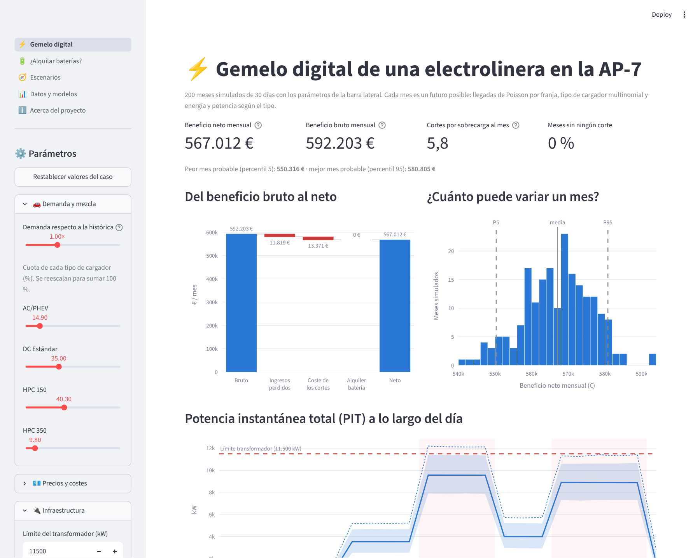
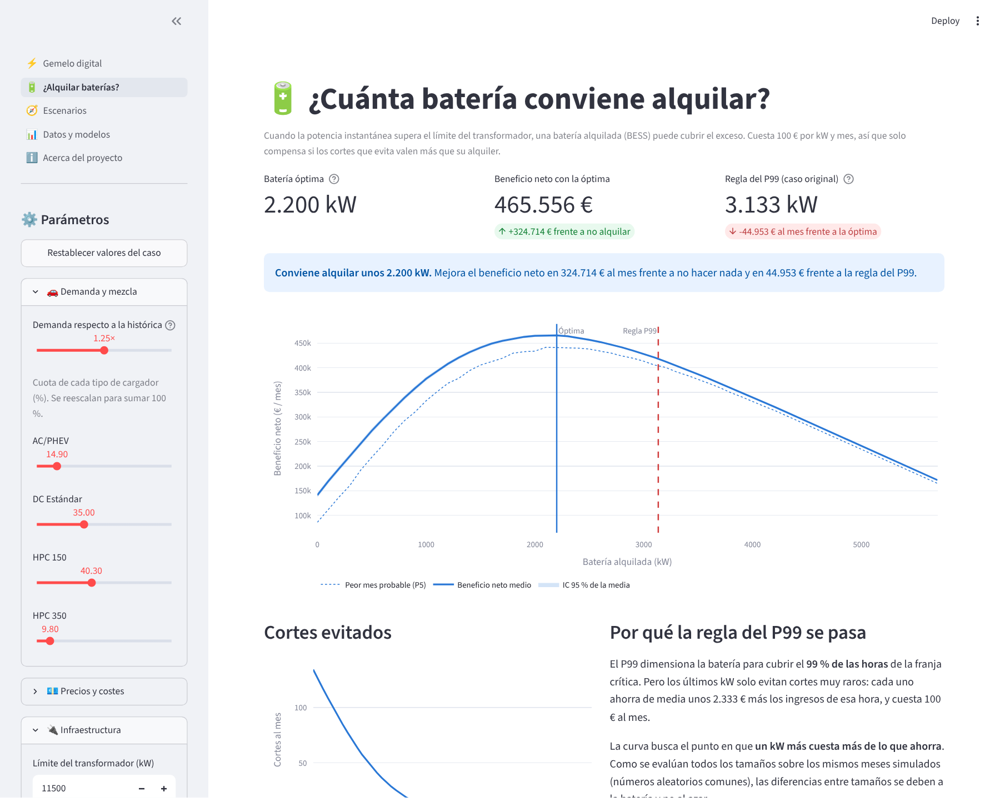

# ⚡ Gemelo digital de una electrolinera de autopista

[](https://github.com/AdrianColomoMoragues/electrolinera-ap7/actions/workflows/ci.yml)

Simulador Monte Carlo interactivo para decidir **cuánto gana una electrolinera, cuánto riesgo de apagones tiene y cuándo compensa alquilar baterías**. Ajusta modelos estocásticos a 30 días de recargas reales, simula miles de meses posibles y busca el tamaño de batería que maximiza el beneficio.

> 🔗 **Demo:** *(enlace de Streamlit Community Cloud, pendiente de publicar)*



## El problema

Una electrolinera en la **AP-7** tiene cargadores de los cuatro tipos del mercado: AC para híbridos enchufables, DC de 50 kW, HPC de 150 kW y HPC de más de 250 kW. Su límite es el **transformador**, que admite 11 500 kW. Si en una hora la potencia que piden los coches que cargan supera ese límite, la protección salta: se pierde la facturación de esa hora y la reparación cuesta entre 1 500 y 3 500 €. Se puede **alquilar una batería** (BESS) que cubra los picos, a 100 € por kW y mes.

Preguntas de negocio:
1. ¿Qué beneficio neto se puede esperar cada mes y con qué variabilidad?
2. ¿Cuántos cortes habrá y en qué franjas?
3. ¿Compensa alquilar baterías? ¿De qué tamaño?
4. ¿Qué pasa si crece la demanda, cambia la mezcla de vehículos o sube el coste de la energía?

## Resultados

| Escenario | Beneficio neto sin batería | Cortes/mes | Batería óptima | Beneficio neto con ella | Regla del P99 |
|---|---:|---:|---:|---:|---:|
| Situación actual | ≈ 567 000 € | ≈ 6 | **0 kW** | ≈ 567 000 € | ≈ 500 kW |
| HPC 350 +10 puntos | ≈ 390 000 € | ≈ 71 | **≈ 1 300 kW** | ≈ 510 000 € | ≈ 2 450 kW |
| Demanda +25 % | ≈ 135 000 € | ≈ 136 | **≈ 2 100 kW** | ≈ 465 000 € | ≈ 3 200 kW |

*Medias de 200 meses simulados; las cifras exactas dependen de la semilla.*

- **Hoy no compensa alquilar baterías.** Cada 100 kW cuestan 10 000 € al mes y evitan ~1 corte, que cuesta unos 4 000 € entre reparación e ingresos perdidos.
- **Más clientes no es más dinero si la red no acompaña.** Con la demanda +25 %, el beneficio bruto sube un 25 %, pero sin batería el neto se hunde por los cortes.
- **La regla clásica del percentil 99 sobredimensiona la batería.** En el escenario HPC 350 +10 pp, la batería óptima (~1 300 kW) gana **más de 50 000 € más al mes** que la del P99 (~2 450 kW), con la mitad de kW. Cubrir el 99 % de los picos sale caro cuando los últimos cortes evitados valen menos que el alquiler.
- **El fin de los subsidios PHEV sube el beneficio bruto pero baja el neto**: se sustituyen recargas lentas y baratas por otras rápidas y caras, que generan más picos de potencia.



## Método

1. **Ajuste de modelos** (`electrolinera/ajuste.py`), validado con pruebas estadísticas:

   | Componente | Modelo | Comprobación |
   |---|---|---|
   | Llegadas por hora | Poisson con una tasa por franja (6 franjas) | varianza/media ≈ 1; χ² de bondad de ajuste, p > 0,1 en todas |
   | Tipo de cargador | Multinomial con cuotas de la AP-7 | χ² de homogeneidad entre franjas, p = 0,22 |
   | Energía (kWh) | Gamma (AC), Normal (DC, HPC 150), Uniforme (HPC 350) | 6 candidatas por máxima verosimilitud, elegidas por AIC; KS p > 0,7 |
   | Potencia (kW) | Fija (AC 11, DC 50), Uniforme 80–130 (HPC 150), Normal (HPC 350) | ídem; independiente de la energía y de la franja |

2. **Simulación Monte Carlo vectorizada** (`electrolinera/simulacion.py`): 200 meses en ~0,5 s. Reproduce los datos reales: 43 087 vehículos frente a 43 076; 593 751 € de beneficio bruto frente a 593 466 €; P99 de la potencia de 11 382 kW frente a 11 406 kW.
3. **Optimización de la batería con números aleatorios comunes**: los meses se simulan una sola vez y todos los tamaños de batería se evalúan sobre las mismas horas y los mismos costes de corte. Así la curva es suave y las diferencias se deben a la decisión, no al azar.
4. **Escenarios** (`electrolinera/escenarios.py`) comparados con la misma semilla.

Hallazgo de los datos: la demanda de la franja **Llano (Mañana) crece a lo largo del mes** (≈ +10 % entre quincenas, p = 0,003). El modelo usa la tasa media, y el control de demanda de la app permite explorar ese crecimiento.

## Cómo ejecutarlo

```bash
git clone https://github.com/AdrianColomoMoragues/electrolinera-ap7.git
cd electrolinera-ap7
python -m venv .venv && source .venv/bin/activate   # en Windows: .venv\Scripts\activate
pip install -r requirements.txt
streamlit run app.py
```

La app solo necesita `modelos/modelos.json` (ya incluido). Para volver a ajustar los modelos desde los datos originales:

```bash
python -m electrolinera.ajuste      # descarga el CSV de la fuente y regenera modelos/modelos.json
pytest -q                           # 25 tests
```

El análisis completo, con la validación y las decisiones técnicas, está en [`Documentation.ipynb`](Documentation.ipynb) (`pip install -r requirements-dev.txt`).

## Estructura

```
electrolinera-ap7/
├── electrolinera/
│   ├── config.py        # franjas, tarifas, costes e infraestructura
│   ├── ajuste.py        # ajuste de distribuciones y pruebas de bondad de ajuste
│   ├── simulacion.py    # Monte Carlo vectorizado, beneficio neto y curva de baterías
│   ├── escenarios.py    # escenarios predefinidos y comparación
│   └── app_utils.py     # barra lateral y caché de la app
├── paginas/             # gemelo digital, baterías, escenarios, datos y modelos, acerca de
├── modelos/modelos.json # parámetros ajustados y resúmenes agregados de los datos
├── tests/               # 25 tests (ajuste, simulación, escenarios, app)
├── Documentation.ipynb  # informe técnico
└── app.py               # punto de entrada de Streamlit
```

## Origen del caso y de los datos

Proyecto propio basado en un caso práctico de una asignatura del **Grado en Ciencia de Datos e Inteligencia Artificial de la Universidad Miguel Hernández**. El planteamiento se ha reescrito, y el código es nuevo: ajuste de distribuciones, simulador vectorizado, optimización de baterías, escenarios y app.

**Datos:** 30 días de registros sintéticos de una electrolinera (43 076 recargas), publicados en el repositorio docente [UMH1477/python](https://github.com/UMH1477/python). Este repositorio no los redistribuye: `python -m electrolinera.ajuste` los descarga de la fuente y solo se guardan los parámetros ajustados y resúmenes agregados.

## Supuestos y limitaciones

- La potencia instantánea de una hora es la **suma de las potencias** de los vehículos que llegan en ella, como en el caso original. Un modelo más realista simularía el solapamiento de las recargas, con su duración `E / (P · 0,9)`.
- En una hora con corte se pierde toda su facturación (se puede desactivar en la app).
- La batería está limitada solo por potencia: se supone que tiene energía suficiente para cubrir el pico.
- Las tasas de llegada son constantes dentro de cada franja y en el tiempo.

## Stack

`Python` · `NumPy` · `SciPy` · `pandas` · `Streamlit` · `Plotly` · `pytest` · `GitHub Actions`
